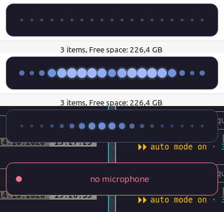

# Development

Everything builds inside the Nix dev shell (Rust toolchain, cmake, libclang, Vulkan headers and loader, PipeWire,
Wayland). Keep parallelism low: whisper.cpp's Vulkan shaders are memory hungry.

```sh
nix develop
export CARGO_BUILD_JOBS=6 CMAKE_BUILD_PARALLEL_LEVEL=6
cargo build --release
cargo test --release                       # unit tests, overlay snapshots (target/overlay-snapshots/*.png)
cargo test --release -- --ignored          # engine test: needs the model and free GPU memory (RUSTLE_TEST_CPU=1 for CPU)
```

## Trying it

```sh
rustle transcribe assets/warmup.wav       # engine check without a microphone; --cpu if the GPU is full
rustle overlay-demo                        # overlay with synthetic audio, no model, no microphone
rustle daemon                              # loads the model, shows the overlay on demand
rustle toggle                              # start recording; run again to transcribe and paste
rustle cancel                              # discard
rustle status
```

`contrib/` has a Hyprland bind snippet (including the Escape submap), a systemd user unit and example
`config.toml` / `theme.toml`.

Overlay on Hyprland (`rustle overlay-demo`): warming up, recording, transcribing, error flash. The dots follow the voice level with automatic gain.



## Home Manager module

`nix/home-manager.nix` is exported as `homeManagerModules.default` (alias `rustle`) by `flake.nix`; usage is in the
README. To check it, build a throwaway Home Manager configuration that imports it (home-manager `release-26.05`,
`wayland.windowManager.hyprland.configType = "hyprlang"`) and inspect `xdg.configFile."rustle/config.toml"`,
`hypr/hyprland.conf` and the `rustle.service` unit. `nix eval .#homeManagerModules.default` only proves it is a function.
Keep the module's `settings` in step with the keys in `src/config.rs`.

## Layout

| path | role |
|---|---|
| `src/state.rs` | pure state machine: `(State, Event) -> (State, [Action])` |
| `src/daemon.rs` | runs the machine, owns the adapters; tested with fakes in `src/daemon/tests.rs` |
| `src/platform/` | one trait per desktop concern (`mod.rs`), Hyprland / PipeWire / layer-shell implementations |
| `src/overlay/` | overlay model and tiny-skia drawing, independent of the windowing system |
| `src/engine.rs` | `Engine` trait and the whisper.cpp implementation |
| `src/overlay/dots.rs` | voice level to dot sizes: automatic gain, outward ripple, easing |
| `src/tokens.rs`, `src/audio.rs` | non-speech token cleanup; level frames, energy gate, WAV loading |

## Speed notes

Warm, a 10 s dictation takes about 0.25 s from stop to text on the RTX 5090. The first transcription in a process can
cost 10 to 15 s when the NVIDIA shader cache misses (ggml-vulkan compiles its shaders on first use), so the daemon
runs a warm-up transcription on its engine thread right after loading. `rustle bench <wav> --runs 3 --pause 8` measures
runs; `__GL_SHADER_DISK_CACHE=0` simulates a cold cache.
